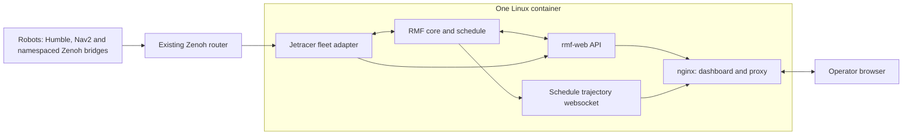

# Architecture and performance

All RMF nodes and the API server share the container's network namespace.
CycloneDDS uses loopback unicast peers, so multicast does not have to cross
Docker Desktop/WSL distro boundaries. The container uses Docker's normal
bridge network, with only nginx's port published. Robot transport is an
outbound connection to the configured router, independent of the internal
ROS domain.

The dashboard uses its browser origin for REST, Socket.IO and trajectory
websockets. nginx strips `/api` before forwarding to the API server and maps
`/trajectory` to the schedule websocket. `RMF_PUBLIC_URL` supplies the API's
externally reachable cache-file URLs and proxy root path. The reporting
websocket at `/_internal` is used only inside the container.

Supervisor manages the four top-level services. API, RMF and adapter start
concurrently; the adapter's existing schedule discovery waits for RMF. Tini
handles orphaned processes and Supervisor sends shutdown signals to process
groups. The healthcheck detects missing ROS children as well as stopped
top-level services; it does not claim that robots or the router are available.

## Build and runtime choices

Released ROS Jazzy/Open-RMF packages provide standard middleware and fleet
infrastructure. Only the small local ROS packages are compiled. The vendored
Free Fleet snapshot preserves this deployment's existing Nav2 fixes and makes
fresh clones independent of nested local checkouts.

API and dashboard are built from one pinned rmf-web Jazzy revision. Its pnpm
lockfile is installed frozen. Python Zenoh, the schema library and ORM versions
are pinned for compatibility with the current fleet and API. Base image tags
and other system/Python dependencies still receive upstream updates, so these
are repeatable source builds rather than fully byte-reproducible builds.

BuildKit caches dependency downloads. Separate build stages keep Node, pnpm
and compilation tooling out of the final image. Navigation graphs and the
production dashboard bundle are built once rather than on container startup.
Runtime uses nginx compression and immutable caching for hashed assets, runs
RMF headless, and limits BLAS/OpenMP thread pools to avoid CPU contention.
Fleet update rates, motion limits and coordinate calibration are preserved.

The container generates a runtime Zenoh config from `.env` and rebases the
fleet map path into its installed package. It retains the configured robot
discovery and five-space parking pool. Map images and SQLite task history are
stored in a persistent named volume; Docker logs are rotated separately.

## Deployment limits

The supplied map, graph and robot profile describe one Jetracer lab. A
different site needs a new building map, graph/calibration and tuned fleet
configuration before dispatching physical robots. Changing `.env` only changes
the network/deployment settings, not physical geometry or robot behavior.

The dashboard retains the upstream development StubAuthenticator. Use a
trusted operator network. Deployments requiring public access need an
identity-provider integration and TLS in front of nginx.

The image workflow builds AMD64 and tests startup without physical robots.
The isolated smoke test checks actual API/websocket transport and receipt of
the map through DDS. Hardware dispatch, localization and traffic negotiation
still require on-site validation. No measured performance claim is made until
the deployed image has been profiled with the actual fleet.
